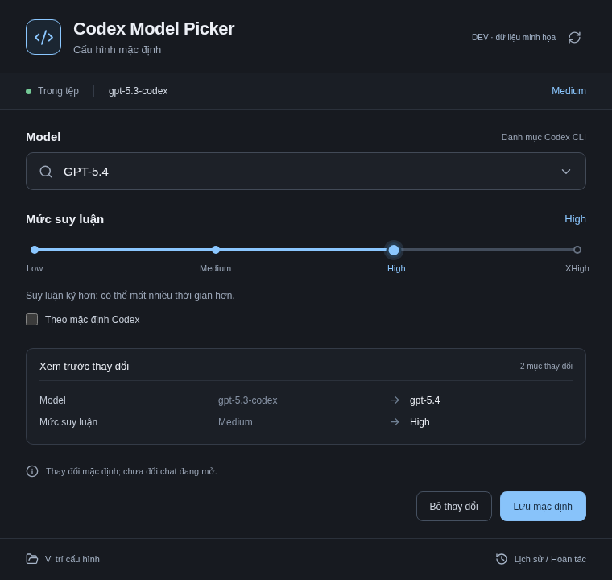

# Codex Model Picker

Ứng dụng Windows độc lập để chọn model và kéo mức suy luận cho cấu hình mặc định Codex. Giao diện tối, xem trước thay đổi, sao lưu và hoàn tác từng mục.



**Trạng thái:** bản đầu đang được kiểm thử. Công cụ chỉnh `config.toml`, không điều khiển chat đang mở. Tích hợp với Codex Desktop trên máy thật cần được xác minh theo [checklist Windows](docs/windows-validation.md).

## Tải và chạy trên Windows

1. Mở tab **Actions** của repo, chọn lần chạy **Test and build Windows app** thành công trên `main`.
2. Trong **Artifacts**, tải `Codex-Model-Picker-Windows-x64`, giải nén rồi chạy `Codex-Model-Picker-0.1.0-Setup.exe`.
3. Bộ cài chạy theo người dùng hiện tại; không cần cài Node.js hoặc Rust để sử dụng app. Bản thử chưa ký số, không phải bản phát hành chính thức của OpenAI. Không xóa dữ liệu app/backup khi gỡ cài đặt.

Artifact chỉ xuất hiện khi job Windows build và smoke-test thành công. Không coi việc source đã được push là bằng chứng bộ cài đã được tạo.

## Sử dụng

1. Hoàn thành tác vụ Codex đang chạy và tránh chỉnh cùng file trong lúc lưu.
2. Mở app, kiểm tra **Vị trí cấu hình**. Mặc định là `CODEX_HOME/config.toml`, hoặc thư mục `.codex` trong home người dùng. Windows và WSL có thể dùng hai file khác nhau.
3. Chọn model. Nếu CLI cung cấp danh mục tương thích, kéo thanh mức suy luận đến nấc mong muốn; cũng có thể chọn **Theo mặc định Codex**.
4. Xem các giá trị trước/sau. Chỉ khi bấm **Lưu mặc định**, file mới được ghi và sao lưu.
5. Mở chat mới trong Codex, kiểm tra model trước khi gửi. Nếu chưa nhận thay đổi, đóng/mở lại Codex sau khi tác vụ hiện tại kết thúc rồi kiểm tra lại. Desktop/profile/Plan có thể ghi đè mặc định này.

**Đã lưu cấu hình** không có nghĩa **chat đang mở đã đổi model**. Tool không mở khóa model hoặc tăng giới hạn context của dịch vụ.

### Danh mục model và Codex CLI

App tìm `codex.exe` trên PATH Windows; có thể chọn executable tại **Vị trí cấu hình → Chọn Codex CLI**. App chỉ dùng `initialize`, `config/read`, `model/list` qua app-server riêng, không gửi prompt, không gọi inference và không điều khiển daemon/phiên Desktop.

Không có CLI phù hợp, đang offline hoặc chưa đăng nhập vẫn mở app được: model hiện tại có nhãn **Chưa xác minh**, có thể nhập model ID thủ công trong ô tìm model. Thanh suy luận chỉ bật khi biết các mức model hỗ trợ; đổi sang model thủ công sẽ đề nghị bỏ effort cũ trong phần xem trước. App không tự cài CLI, không yêu cầu nhập token vào UI. Wrapper `.cmd` không được chạy qua shell. Tệp được chọn cần tên `config.toml` và cùng home/provider với CLI để xác minh danh mục; profile đang hoạt động có thể khiến bước này không khả dụng.

Danh mục CLI không bảo đảm tài khoản có quyền chạy mọi model trong danh sách. Không có danh sách model giả trong bản desktop đóng gói.

### Tự sửa TOML và hoàn tác

Bạn vẫn tự sửa file bất kỳ lúc nào. Dùng **Tải lại** trong app để đọc lại sau khi sửa. Nếu revision đã thay đổi, thao tác lưu bị từ chối để tránh ghi đè.

**Lịch sử / Hoàn tác** chỉ hoàn tác các mục mà lần lưu đó đã đổi. Các mục khác, kể cả effort bạn sửa sau một lần chỉ đổi model, được giữ lại. Nếu chính mục cần hoàn tác đã được sửa tiếp, app báo xung đột. Backup gốc không được chép đè toàn bộ lên file mới.

App giữ chú thích, UTF-8 BOM và CRLF/LF; chỉ quản lý hai khóa gốc `model`, `model_reasoning_effort`. Không sửa provider, profile, quyền chạy lệnh, context, bộ cài Codex, đăng nhập hay lịch sử chat. Các phiên Codex đọc chung file này về sau có thể nhận mặc định mới.

Backup và metadata nằm trong thư mục `history` dưới Electron userData (Windows mặc định `%APPDATA%\codex-model-picker`). Backup là toàn bộ file gốc, có thể chứa cấu hình riêng tư của bạn: app không đẩy chúng lên GitHub, không hiển thị nội dung backup, và tạo tệp với quyền riêng người dùng. Các lần chọn file/CLI thủ công hiện chỉ áp dụng trong phiên mở app; lần mở kế tiếp phát hiện lại mặc định.

Kiểm tra xung đột dùng SHA-256 trước khi thay thế tệp; đây là kiểm tra lạc quan, không phải khóa được mọi trình sửa bên ngoài. Vẫn có khoảng đua nhỏ giữa lần kiểm tra cuối và rename. Tệp chỉ đọc, symlink/junction hoặc TOML không hợp lệ sẽ không được sửa; chọn file gốc hoặc sửa lỗi rồi tải lại.

## Phát triển

Node.js 24.x và npm 11.x; dùng checkout hiện tại, không cần tạo worktree mới trong cloud.

```sh
npm ci
npm run setup:electron
npm run dev
```

Electron 44 tải binary bằng lệnh `install-electron` của package, qua `setup:electron`. Lệnh giữ kiểm tra TLS và checksum của Electron. Môi trường proxy cần cấu hình trust/proxy hợp lệ, không tắt xác minh.

```sh
npm run typecheck
npm test
npx playwright install chromium
npm run test:e2e -- --project=renderer
npm run test:e2e -- --project=desktop
npm run dist:win
```

`npm test` build trước khi chạy để kiểm tra cả preload đóng gói trong sandbox. Test đọc/ghi chỉ dùng thư mục tạm. Desktop E2E cần Windows hoặc display/sandbox Linux được hỗ trợ; bỏ qua có báo rõ nếu không có display. Không tắt sandbox Electron để ép kiểm tra qua. Job Windows kiểm tra cả app từ source và app đã đóng gói, trên file tạm có đường dẫn Unicode.

### Preview UI trong cloud

```sh
npm run dev:ui
```

Đây là **DEV · dữ liệu minh họa**, chỉ mô phỏng trạng thái trong bộ nhớ và không sửa cấu hình thật. Dữ liệu demo bị loại khỏi production bundle. Browser UI tests kiểm tra chuột/bàn phím, save/undo mô phỏng và các viewport; chúng không thay thế desktop E2E hoặc kiểm thử Codex thật.

Nếu npm không ghi được cache trong home của cloud, dùng `npm_config_cache=/tmp/codex-model-picker-npm`. Electron cache tương ứng là `electron_config_cache=/tmp/codex-model-picker-electron`. Không lưu token hoặc file cấu hình thật vào repo.

## Tài liệu

- [Thiết kế UI và hành vi](docs/superpowers/specs/2026-10-15-model-picker-design.md)
- [Kế hoạch triển khai](docs/superpowers/plans/2026-10-15-model-picker.md)
- [Nghiên cứu giao thức và giới hạn Desktop](docs/model-picker-notes.vi.md)
- [Kết quả kiểm thử và việc cần xác minh trên Windows](docs/windows-validation.md)
- [Trạng thái triển khai và review](docs/implementation-status.md)
